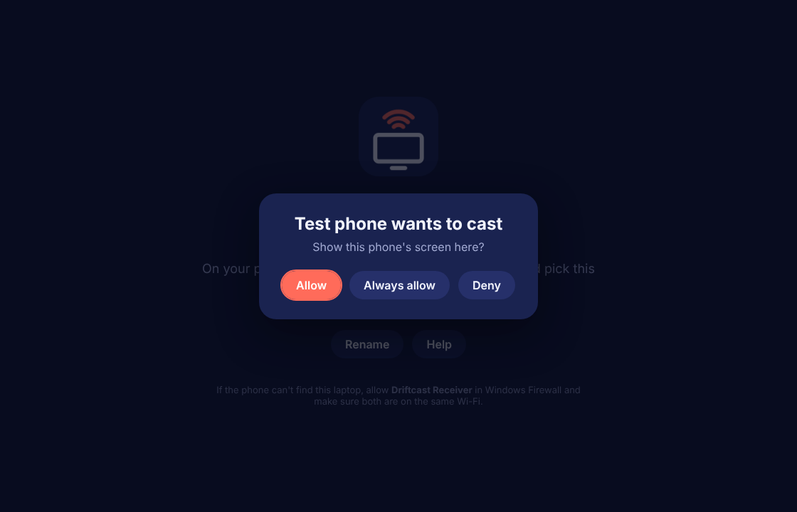
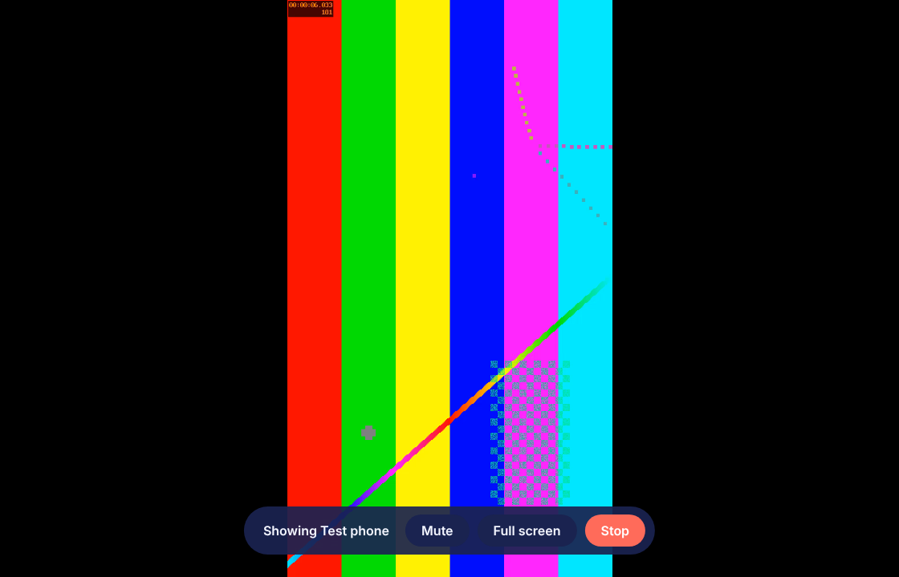

# Driftcast

Show your Android phone's screen and sound on a TV, a laptop or another phone, over the same Wi-Fi, in two taps.

| Route | On the phone | On the other screen |
| --- | --- | --- |
| Phone to TV | Driftcast app | Driftcast app on Android TV / Google TV (opens straight into Receive) |
| Phone to laptop | Driftcast app | **Driftcast Receiver** for Windows |
| Phone to phone | Driftcast app | Driftcast app, tap **Receive here** |

## How to use

1. On the screen you want to watch on, open Driftcast (or Driftcast Receiver on Windows). It shows its name, for example "Living room TV".
2. On your phone, open Driftcast and tap **Cast my screen**.
3. Tap the screen's name and accept Android's "start recording or casting" prompt.
4. On the TV or laptop, press **Allow** (or **Always allow** to skip this next time).

Stop from the phone's notification, the phone app, or the Stop button on the receiver (TV remote: press OK to show it, or Back).

## Getting the apps

Every push builds both apps on GitHub Actions. Open the latest green run under **Actions** and download:

- `Driftcast-Android-apk`: one APK for phones, tablets and Android TV. On a TV, install it with a USB stick and a file manager, or with "Send files to TV" / `adb install`.
- `Driftcast-Receiver-Windows-installer`: run it once. It adds a Windows Firewall rule so phones can reach the laptop.

## Good to know

- **Sound plays on**: pick **TV / laptop** (the phone goes quiet), **Both**, or **This phone** (only the picture is sent, handy with earphones). You can switch while casting. Receivers also have a **Mute** button.
- Sound needs Android 10 or later on the sending phone. Apps that block screen recording (Netflix-style DRM, some banking apps) show black or are silent by design.
- Both devices must be on the same Wi-Fi, and the router must let devices see each other (guest networks often block this). If the phone can't find a screen, use **Enter an address instead** with the address shown on the receiver.
- Quality: **Smooth 720p** (about 5 Mbit/s) or **Sharp 1080p** (about 8 Mbit/s), both up to 60 fps.

## How it works

- Receivers broadcast a small JSON beacon on UDP 47901 every second. The phone lists what it hears.
- The phone connects on TCP 47900, says hello, and the receiver answers Allow or Deny.
- Video: Android `MediaProjection` into the phone's hardware H.264 encoder (`MediaCodec`). Rotating the phone rebuilds the encoder at the new size.
- Sound: Android 10 `AudioPlaybackCapture`, sent as 48 kHz stereo PCM.
- Android receivers decode with `MediaCodec` onto a `SurfaceView` and play sound with `AudioTrack`. The Windows receiver (Electron) decodes with WebCodecs and plays with Web Audio.
- Packets: 1 byte type, 4 byte length, 8 byte timestamp, data. See `android/app/src/main/java/app/driftcast/Proto.java` and `windows/src/protocol.js`.

## Project layout

```
android/   Android app (Java, no extra libraries): sender, receiver, TV launcher entry
windows/   Windows receiver (Electron)
  tools/fake-phone.js   pretends to be a phone and streams a test pattern + tone
  tools/e2e.js          launches the receiver, casts to it, saves screenshots
branding/  logo source
```

Develop the Windows receiver with `cd windows && npm install && npm start`. Test without a phone: `node tools/fake-phone.js 10` while the receiver is open.



